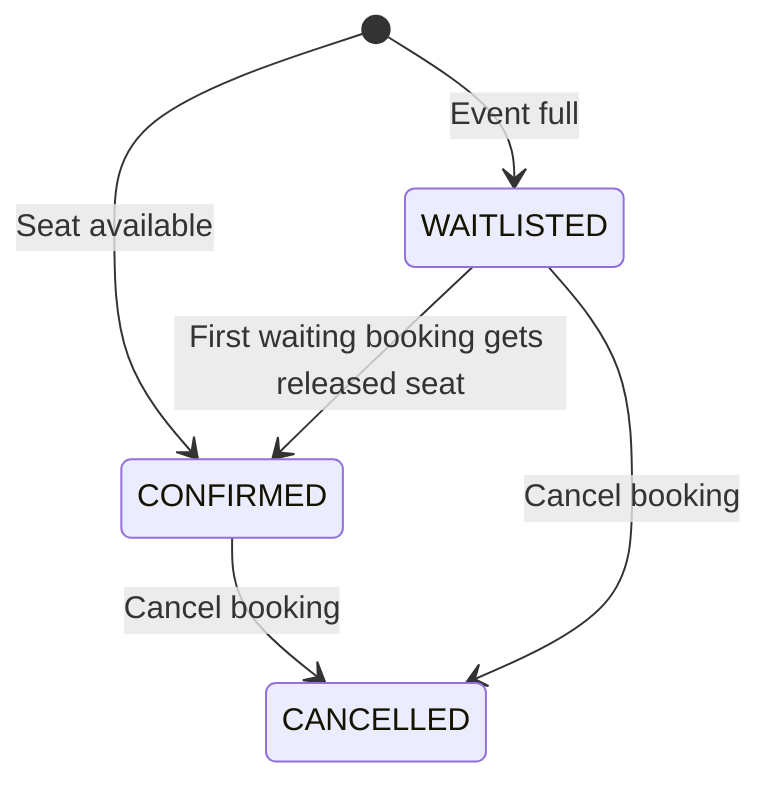

# Event Booking & Waitlist

A full-stack application for reserving event seats, joining a waitlist, and automatically allocating a released seat to the next person in line.

Built with React, Vite, Express and MongoDB by Akhil Choudhary.

## Features

- Session-based signup, login and logout.
- Public event listings with available-seat counts.
- Confirmed bookings while seats remain; waitlisted bookings when an event is full.
- Automatic FIFO waitlist promotion after a confirmed booking is cancelled.
- User-owned bookings and server-enforced admin permissions.
- Admin event creation, booking lists and cancellation.
- Persistent users, events, bookings and sessions in MongoDB.

## Booking lifecycle



When a confirmed booking is cancelled, the oldest waiting booking is promoted. If nobody is waiting, the available-seat count increases. Cancelling an already-cancelled booking does not release another seat.

## Design decisions

**Atomic seat changes.** Booking and cancellation use Mongoose transactions. Both first update the same event document, giving competing operations on that event a common write-conflict point. Seat counts, booking creation and promotion are committed together.

**Deterministic queue order.** Promotion sorts waiting bookings by `createdAt`, then `_id` to break ties.

**Identity from the session.** The backend takes the booking name, email and user ID from the signed-in account. Submitted identity fields cannot choose another owner.

**Database indexes.** A unique `{ eventId, email }` index rejects duplicate bookings. A `{ eventId, userId }` index supports ownership-scoped queries. User emails also have a unique index.

**Authentication.** Passwords are hashed with bcrypt. MongoDB-backed sessions use HttpOnly, SameSite=Lax cookies; successful login regenerates the session. Auth attempts are rate-limited. Mutating API requests require the application's custom header, and supplied origins are checked against an allowlist.

## Permissions

| Action | Guest | User | Admin |
|---|---|---|---|
| Browse events | Yes | Yes | Yes |
| Create an event | No | No | Yes |
| Book or join a waitlist | No | Own account | Own account |
| View bookings | No | Own bookings | All bookings |
| Cancel a booking | No | Own booking | Any booking |

Authorization is checked by the API as well as reflected in the interface.

## Run locally

Use Node.js 24, npm and a MongoDB Atlas database (or another transaction-capable replica set). Standalone MongoDB does not support the multi-document transactions used here; see the [MongoDB transaction requirements](https://www.mongodb.com/docs/manual/core/transactions-production-consideration/#availability).

From a fresh clone, install dependencies:

```bash
npm ci --prefix server
npm ci --prefix client
```

Create the server's local configuration if it does not already exist:

```bash
test -e server/.env || cp server/.env.example server/.env
```

Edit `server/.env`:

| Variable | Value |
|---|---|
| `MONGODB_URI` | Your Atlas connection string; URL-encode special characters in database credentials |
| `SESSION_SECRET` | A random secret of at least 32 characters |
| `DNS_SERVERS` | Optional comma-separated DNS servers; leave blank unless needed |
| `APP_ORIGINS` | Optional local override; defaults include localhost/127.0.0.1 on ports 5173, 5174 and 3001 |

Generate a session secret locally with:

```bash
node --input-type=module -e 'import { randomBytes } from "node:crypto"; console.log(randomBytes(32).toString("hex"))'
```

Use that output for `SESSION_SECRET`. The application uses the database named `event_booking`. Configure Atlas database access and allow the development machine's IP address to connect.

Start the API in one terminal:

```bash
cd server
npm run dev
```

From the repository root, start the frontend in another terminal:

```bash
cd client
npm run dev
```

Open the Vite terminal's `Local` URL. The API listens on port 3001, and Vite proxies `/api` requests to it. Keep both terminals running. If Vite selects a port beyond 5174, include that frontend origin in `APP_ORIGINS` and restart the backend.

### Set up an admin

All new accounts have the `USER` role. First sign up through the application. Then, from the repository root, run the following local database command, replacing `you@example.com` with that account's email:

```bash
cd server && ADMIN_EMAIL="you@example.com" node --input-type=module <<'ADMIN_SETUP'
import "dotenv/config";
import mongoose from "mongoose";
import { setServers } from "node:dns/promises";
import User from "./models/User.js";

try {
  const email = process.env.ADMIN_EMAIL?.trim().toLowerCase();
  if (!email || !/^[^\s@]+@[^\s@]+\.[^\s@]+$/.test(email)) {
    throw new Error("Set ADMIN_EMAIL to the existing account email");
  }
  const dns = process.env.DNS_SERVERS?.split(",").map(s => s.trim()).filter(Boolean);
  if (dns?.length) setServers(dns);
  await mongoose.connect(process.env.MONGODB_URI, {
    dbName: "event_booking",
    serverSelectionTimeoutMS: 10000
  });
  const user = await User.findOneAndUpdate(
    { email },
    { $set: { role: "ADMIN" } },
    { returnDocument: "after", upsert: false, runValidators: true }
  ).select("email role");
  console.log(user ? "ADMIN ready: " + user.email : "Account not found; no change made.");
  if (!user) process.exitCode = 1;
} catch (error) {
  console.error("Admin setup failed:", error.name);
  process.exitCode = 1;
} finally {
  await mongoose.disconnect();
}
ADMIN_SETUP
```

Log in with that account and reload the page to see **Create an event** and **View all bookings**. No public API accepts a role during signup.

## API

Authentication uses the session cookie. POST requests from the frontend send `X-Requested-With: EventBooking`; requests with bodies use `Content-Type: application/json`.

| Method | Endpoint | Access / purpose |
|---|---|---|
| GET | `/api/health` | Health response |
| GET | `/api/events` | Public event list |
| POST | `/api/events` | Admin; title, venue, startsAt, capacity |
| POST | `/api/auth/signup` | Public; name, email, password |
| POST | `/api/auth/login` | Public; email, password |
| POST | `/api/auth/logout` | Destroy the current session |
| GET | `/api/auth/me` | Current account, or null |
| POST | `/api/events/:eventId/bookings` | Signed in; identity comes from the session |
| GET | `/api/events/:eventId/bookings` | Own bookings for users; all for admins |
| POST | `/api/events/:eventId/bookings/:bookingId/cancel` | Owner or admin |

Signup passwords require at least 15 characters and at most 72 UTF-8 bytes. Creating and cancelling bookings is blocked after an event starts, except that repeating an already-completed cancellation remains idempotent.

## Validation

From the repository root:

```bash
node checks/access-check.mjs
npm --prefix client run lint -- src vite.config.js
npm --prefix client run build
```

The access check executes the actual route handlers and auth guards with in-memory model doubles. It covers anonymous access, admin restrictions, forged booking identity, ownership-scoped lists, cross-user cancellation, legacy records, promotion privacy, duplicate bookings, repeated cancellation and failure/rollback paths. It does not connect to MongoDB or start an HTTP server.

Local manual checks also covered:

- One user cannot see another user's booking.
- An anonymous request to the bookings endpoint returns 401.
- An admin can create an event and view other users' bookings.
- A one-seat event confirms the first booking and waitlists the next.
- Admin cancellation promotes the waiting booking, and its status survives a page refresh.

Live database concurrency/load tests and automated browser integration tests are not included. The server's default `npm test` script is still a placeholder; use the access-check command above for the included handler checks.

## Project layout

| Path | Responsibility |
|---|---|
| `client/src/` | React account, event, booking and admin interface |
| `client/vite.config.js` | Local API proxy |
| `server/index.js` | Event and booking API; transactions |
| `server/auth.js` | Sessions, authentication and access guards |
| `server/models/` | User, Event and Booking schemas |
| `server/.env.example` | Configuration template without credentials |
| `checks/access-check.mjs` | Handler and authorization checks |

## Current scope

This is a local development project. Cancelled bookings remain in the history, and the unique event/email index currently prevents rebooking the same event with the same email. Legacy bookings without a user ID are visible to admins only.

Email verification, password reset, event editing/deletion, pagination and live seat updates are not implemented. The rate limiter is process-local. Production deployment still needs HTTPS, the appropriate proxy/cookie configuration and frontend API routing; there are no published throughput or scale claims.

